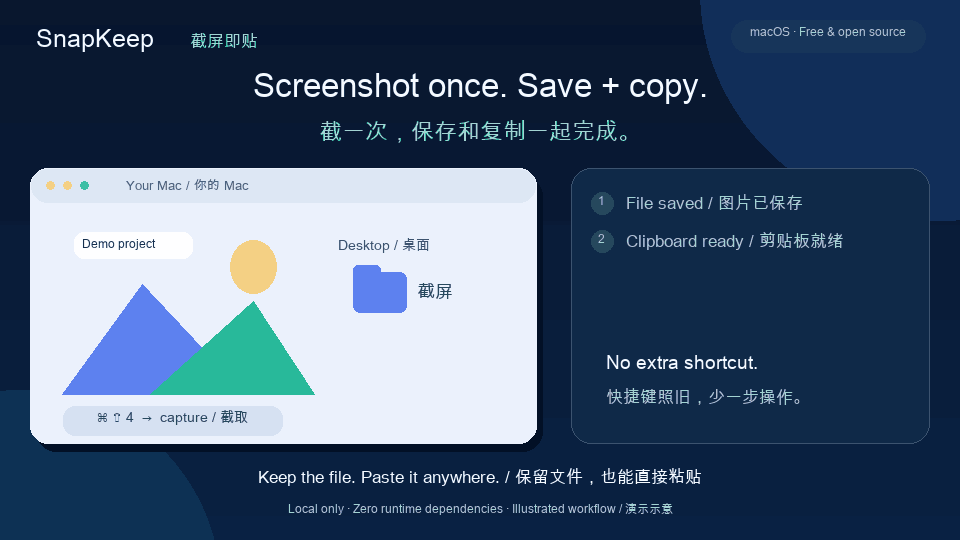
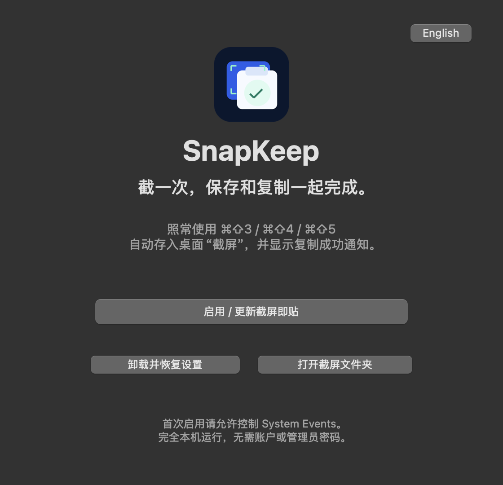
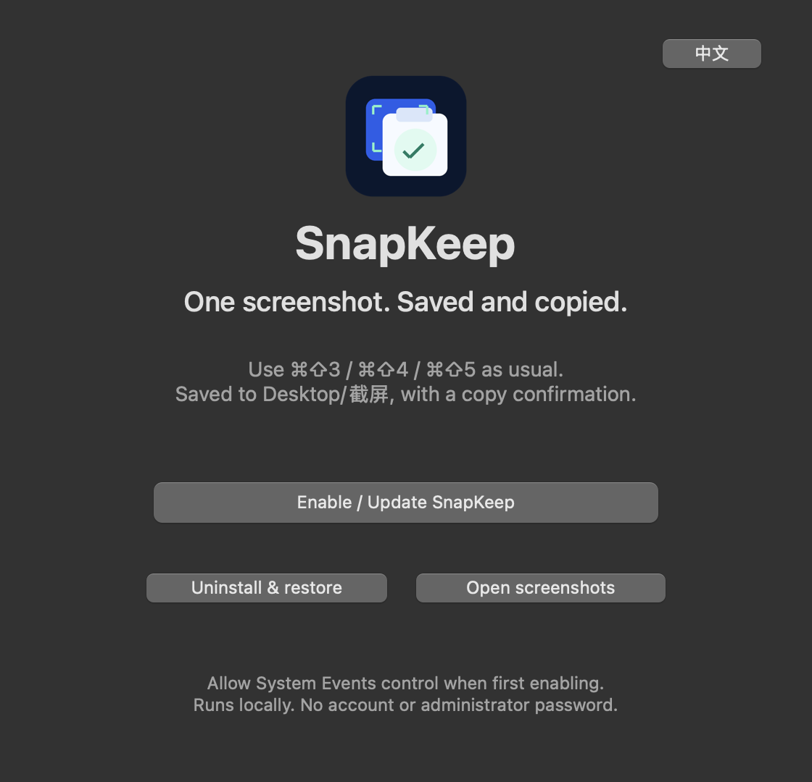

<div align="center">



# SnapKeep · 截屏即贴

**截一次，保存和复制一起完成。**

用熟悉的 Mac 截屏快捷键，自动存入桌面文件夹，随手 ⌘V 粘贴。

**One screenshot. Saved and copied.**

macOS screenshot automation with an installable Agent Skill: keep the file, copy the image, and paste with ⌘V. Works with compatible Codex and Claude Code skill workflows.

[中文介绍](#截完屏还要再复制一次) · **[English ↓](#english)** · [Full English README](README_EN.md) · [Agent Skill / 技能安装](#agent-skill--技能安装) · **[Download / 下载](https://github.com/TonT-wilshere/macos-screenshot-clipboard/releases/latest)**


[](https://github.com/TonT-wilshere/macos-screenshot-clipboard/actions/workflows/ci.yml)
[](https://github.com/TonT-wilshere/macos-screenshot-clipboard/releases/latest)
[](https://github.com/TonT-wilshere/macos-screenshot-clipboard/releases)
[](https://github.com/TonT-wilshere/macos-screenshot-clipboard/stargazers)

</div>

## Agent Skill / 技能安装

**`macos-screenshot-save-copy` — Mac 截屏保存与剪贴板自动化 / macOS screenshot save-and-copy automation.**

这份 Agent Skill 帮助兼容的 Codex、Claude Code 等代理安装、配置和排查 SnapKeep，处理“Mac 截屏同时保存和复制”“截图自动复制到剪贴板”“截屏自动存入桌面文件夹”等请求。

The skill helps compatible agents set up and troubleshoot **macOS screenshot automation**, **save and copy screenshots**, and **automatically copy screenshots to clipboard** while keeping an image file. It covers screenshot-folder setup, System Events permissions, image-data verification, and uninstall/restore.

```bash
npx skills add TonT-wilshere/macos-screenshot-clipboard --skill macos-screenshot-save-copy -g
```

安装的是代理的操作说明；启用自动复制仍需按 Skill 指引配置 SnapKeep 应用。Installing the skill adds agent instructions; enabling screenshot copying still requires SnapKeep setup.

[查看 SKILL.md / Read the skill](skills/macos-screenshot-save-copy/SKILL.md) · [技能目录 / Skill catalog](skills/README.md) · [AI 可读项目摘要 / Retrieval summary](llms.txt)

## 截完屏，还要再复制一次？

截图给朋友、贴进笔记、向开发者反馈 Bug，或者把界面交给 AI 看。我们经常既想留下一份图片，又想立刻粘贴出去。

macOS 的默认快捷键把截屏存成文件；加上 Control 可以直接复制，但不会保留文件。SnapKeep 把这两件事连起来：**照常截屏 → 文件自动保存 → 图片自动复制 → 直接粘贴**。

它不增加新的截屏快捷键。你原来怎么截，现在还怎么截。

## 能做什么

| 你在意的事 | SnapKeep 的行为 |
| --- | --- |
| 留住文件，也能马上粘贴 | 截屏保存到 `桌面/截屏` 后复制图片本身 |
| 不想反复点确认 | 成功后只发“已复制到剪贴板”通知，不打开查看器 |
| 快捷键已经用习惯 | 保持 `⌘⇧3`、`⌘⇧4`、`⌘⇧5` |
| 桌面越来越乱 | 新截屏统一收进一个文件夹 |
| 给朋友安装 | 中英文原生设置界面，Universal 安装包 |
| 不想让小工具一直占着 Dock | 配置好即可退出，系统文件夹操作继续处理截屏 |
| 担心图片隐私 | 本机处理，无账户、无上传、无遥测 |
| 不喜欢了要卸载 | 一键移除自己的规则，恢复原保存设置并保留全部截屏 |

适合聊天发图、写文档、记笔记、Bug 反馈和向 AI 助手提供界面截图。粘贴是否成功仍取决于目标应用是否接受图片。

## 下载与安装

1. 从 [Releases](https://github.com/TonT-wilshere/macos-screenshot-clipboard/releases/latest) 下载 **`SnapKeep-1.0.0-macOS-Universal.dmg`**，或选择 ZIP。
2. 把 `SnapKeep.app` 拖入“应用程序”，打开它。
3. 点击“启用 / 更新截屏即贴”。首次启用时允许 SnapKeep 控制 **System Events（系统事件）**。
4. 用 `⌘⇧4` 截一张图，等图片保存后按 `⌘V` 粘贴。

支持 Apple Silicon 和 Intel，最低 macOS 12。构建已在 macOS 15 上验证；其他系统版本欢迎反馈。

 

**当前是未经 Apple 公证的独立开源构建。** 首次打开若被拦截，请参考 [Apple 官方说明](https://support.apple.com/zh-cn/102445)，在“系统设置 → 隐私与安全性”中选择“仍要打开”。无需关闭 Gatekeeper 或系统完整性保护。

安装之后可以退出 SnapKeep。再次打开应用可以切换通知语言、更新或卸载；卸载不会删除任何截屏。右上角可切换中文 / English，首次跟随系统语言。

## 使用边界

- 自动复制发生在**图片文件保存后**。macOS 浮动缩略图尚未保存时可能需要等几秒；可以在 `⌘⇧5 → 选项` 中按自己的偏好关闭浮动缩略图。
- 不要额外按 Control；系统的 Control 截屏组合键只复制、不保存。
- 监听 `桌面/截屏` 中新增的 PNG、JPEG、HEIC/HEIF、TIFF。手动放入该文件夹的这些图片也会触发复制；录屏不会复制。
- 多张图一起到达时，剪贴板保留最后成功处理的图片。它不是剪贴板历史工具。
- 安装期间会短暂刷新全局文件夹操作开关，以让系统加载新规则；其余文件夹规则保留。
- 如果安装后你手动修改了截屏保存位置，SnapKeep 不会跟随新目录。卸载时也不会覆盖你新选的位置。

## 常见问题

**没有自动复制？**

先确认文件确实进了 `桌面/截屏`。打开 SnapKeep 再点“启用 / 更新”；如果之前拒绝过权限，在“系统设置 → 隐私与安全性 → 自动化”允许 SnapKeep 控制 System Events。也可以在 macOS“文件夹操作设置”中核对规则是否启用。

**没有看到通知，但可以粘贴？**

检查“系统设置 → 通知”中的文件夹操作调度器 / 脚本通知，以及专注模式。通知由 macOS 决定是否展示，关闭通知不影响图片复制。

**每次弹出“查看新项目”？**

那通常是 Apple 示例 `add - new item alert.scpt`。SnapKeep 安装时会从此截屏目录解绑这个示例，并迁移本工具早期的中文脚本。

## 从源码构建

需要 macOS 与 Xcode Command Line Tools。应用运行和正常构建都无需第三方依赖；Python/Pillow 仅用于重新生成宣传素材。

```bash
git clone https://github.com/TonT-wilshere/macos-screenshot-clipboard.git
cd macos-screenshot-clipboard
./Scripts/check.zsh
./build.sh
open build/SnapKeep.app
```

`./package.sh` 生成 Universal DMG、ZIP 和 SHA-256。构建包含 `arm64 + x86_64`，CI 检查 AppleScript 编译、签名结构和双架构。有关签名/公证见 [NOTARIZATION.md](NOTARIZATION.md)。

## 隐私与实现

原生 Swift/AppKit 界面负责配置，AppleScript 文件夹操作监听新图片，AppKit 把图片数据写入系统剪贴板，再发一个系统通知。没有后台网络服务、管理员 helper 或额外 LaunchAgent；关闭设置窗口后由 macOS 自带调度器运行规则。

截图和剪贴板内容不会被本项目上传。剪贴板仍受 macOS 及其他剪贴板工具的正常行为影响；例如用户开启的通用剪贴板可能同步内容。详情见 [SECURITY.md](SECURITY.md)。

## 参与与支持

[报告问题](https://github.com/TonT-wilshere/macos-screenshot-clipboard/issues) · [贡献说明](CONTRIBUTING.md) · [MIT License](LICENSE)

如果它替你省下了反复找文件、再复制的一步，欢迎点个 **Star**，也把下载链接发给有同样习惯的朋友。⭐

## English

### SnapKeep: macOS screenshots saved and copied together

SnapKeep is a local macOS screenshot utility with a companion **Agent Skill** for screenshot and clipboard automation. Take a screenshot with your usual `⌘⇧3`, `⌘⇧4`, or `⌘⇧5` shortcut. The image is saved to `Desktop/截屏` and copied to the clipboard after saving, ready to paste into a chat, note, bug report, or AI conversation.

macOS normally saves a screenshot as a file; adding Control copies it instead of saving it. SnapKeep provides the combined save-and-copy workflow without adding another screenshot shortcut.

### Features

- Save the image file and automatically copy image data to the clipboard.
- Show a “Copied to clipboard” notification without a viewer prompt.
- Keep familiar screenshot shortcuts and organize files in one desktop folder.
- Use a native Chinese/English setup UI; quit it after configuration while macOS Folder Actions continues working.
- Support Apple Silicon and Intel in one Universal build targeting macOS 12+; functional behavior has been verified on macOS 15.
- Process images locally, without an account, upload, or telemetry.
- Uninstall while keeping all screenshots and restoring pre-install settings where still managed by SnapKeep.

### Download & enable

1. Download the Universal DMG or ZIP from [Releases](https://github.com/TonT-wilshere/macos-screenshot-clipboard/releases/latest).
2. Move `SnapKeep.app` to Applications and open it.
3. Click **Enable / Update SnapKeep** and allow **System Events** automation.
4. Capture with `⌘⇧4`, wait for the image to save, then paste with `⌘V`.

The current release is not Apple-notarized. If first launch is blocked, follow [Apple's Open Anyway instructions](https://support.apple.com/en-us/102445). No administrator password is needed for screenshot configuration.

### Install the Agent Skill

```bash
npx skills add TonT-wilshere/macos-screenshot-clipboard --skill macos-screenshot-save-copy -g
```

The companion skill teaches compatible agents how to install, configure, verify, troubleshoot, and remove this workflow. It is intended for requests such as “save and copy Mac screenshots,” “automatically copy screenshots to clipboard,” and “organize screenshots in a desktop folder.” Skill installation and app setup are separate steps.

To check repository discovery without installing:

```bash
npx skills add TonT-wilshere/macos-screenshot-clipboard --list
```

### Behavior and privacy

Copying begins when the image file is saved; the macOS floating thumbnail may delay saving. New PNG/JPEG/HEIC/HEIF/TIFF images in the folder trigger copying, including manually added images. Recordings are ignored. Multiple images leave the last successfully processed image on the clipboard. Focus and notification settings may hide the success banner without preventing copying.

The tool uses Apple's Folder Actions and AppKit. It uploads no images and stores no clipboard history. macOS Universal Clipboard and other clipboard apps still behave according to your settings. Uninstall respects a different screenshot destination you selected later.

[Full English documentation](README_EN.md) · [Agent Skill](skills/macos-screenshot-save-copy/SKILL.md) · [Build instructions](#从源码构建) · [Security](SECURITY.md) · [MIT License](LICENSE)

If SnapKeep saves you a step, a **Star** helps other Mac users find it. ⭐
